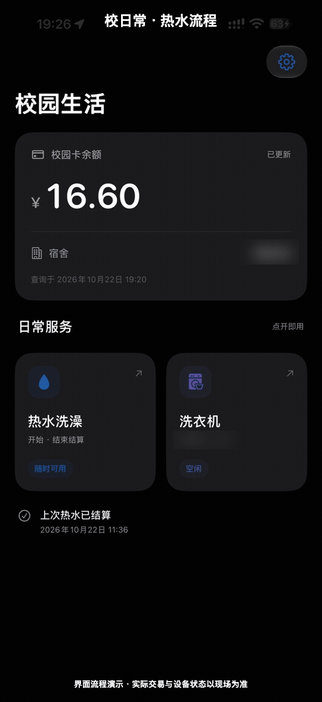
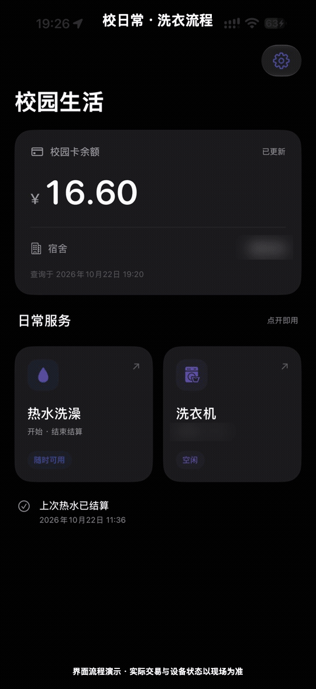
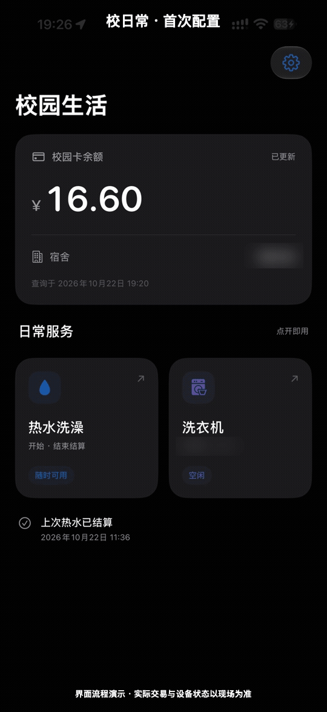

# Campus Daily / 校日常

广东工商职业技术大学的非官方 iPhone 校园生活工具。把校园卡余额、宿舍、热水和 U净洗衣放进一个 App，少走几次小程序入口，少看几次无关页面。

这是我自己每天都要用的工具：洗澡、洗衣服本来只需要几步，却被分散在不同小程序和跳转里。校日常把常用数据和操作收在一起；桌面名称是「校日常」，首页叫「校园生活」。

**当前是面向有基础能力同学的自签名测试版。没有 TestFlight；GitHub 提供的是无签名开发 IPA，下载后必须用你自己的 Apple 身份签名才能安装。** 免费 Apple Personal Team 通常每 7 天后要重新签名；后续会研究更稳定的证书和分发方式。

## 下载

[下载 0.7.0 build 28 无签名 IPA](https://github.com/JasonBeam/campus-daily/releases/download/v0.7.0/CampusDaily-0.7.0-build28-unsigned.ipa) · [下载说明与当前门槛](docs/download.md)

下载后自行签名安装；首次热水配置仍需合法取得的平台配置，公开包不含作者的私测参数。

## 配置教程与 AI 上手

新用户不需要照着抓包猜字段，优先按 App 内流程走：

1. 打开「设置 → 校园登录与宿舍」，使用学校官方网页登录。
2. 逐级选择校区、楼栋、楼层和寝室，核对目标水控后保存。
3. 打开「常用洗衣机」，使用本人 U净绑定手机号完成短信登录。
4. 扫描或从照片识别洗衣机机身二维码，保存为常用机器。

详细说明：

- [配置与使用边界](docs/configuration.md)：各功能配置、导入格式与禁止公开的数据。
- [构建与签名](docs/build-and-signing.md)：获取 SDK、生成工程、编译和无签名 IPA。
- [AI 辅助上手](docs/ai-guide.md)：可直接交给 AI 的排错提示，包括安装、配置和异常处理边界。
- [故障排查](docs/troubleshooting.md)：登录、蓝牙、二维码、订单和签名问题。

## 当前能做什么

| 功能 | 当前行为 |
| --- | --- |
| 校园卡与宿舍 | 显示余额、宿舍和查询时间；失败保留上次有效结果并明确标记。 |
| 热水洗澡 | iPhone 通过蓝牙连接已配置水控，开始前申请本次授权，结束后提交结算。App 不观察真实水流。 |
| 热水快捷指令 | 提供「开始洗澡」「结束结算」两个 App Intents，可加入快捷指令、主屏幕或支持机型的操作按钮。 |
| U净洗衣 | 本人手机号与验证码登录，常用机器扫码绑定，查询空闲状态、程序、时长和价格，核对后可前往支付宝。 |
| 订单保护 | 本机保存订单与未确认阶段，异常时阻止重复创建、付款或结算；符合条件的未付款预约可取消。 |
| 校园自助配置 | 在 App 内使用学校官方网页登录，选择校区、楼栋、楼层和寝室。 |

## 动态界面演示

以下动画是根据已脱敏实机界面制作的**流程演示**，帮助快速理解页面关系；它们不是实际出水、扣费或洗衣机启动录像，真实交易以现场和官方页面为准。

<p>
  
  
  
</p>

原分辨率视频在 [`docs/media`](docs/media)：热水流程、洗衣流程和首次配置各有 GIF 与 MP4。

## 为什么做它

- 每天都要用的校园服务散落在多个小程序里，入口难找。
- 页面跳转、加载和无关内容会拉长一次简单操作。
- 宿舍热水和 U净是两套不同设备与账号，分别维护经常容易混淆。
- 常用数据适合放在首页，而不是每次重新找入口。
- 交易异常时应该保留结果，不能靠反复点击碰运气。

校日常只围绕我实际使用过的广东工商职业技术大学环境开发，不代表学校、水控服务商、U净或支付宝，也不声称其他学校直接通用。

## 开始之前

需要：

- macOS、完整 Xcode、Swift 6 工具链，以及能签名的 Apple 账号。
- iOS 17 或更新系统的 iPhone。
- 本人合法取得的学校与 U净登录条件；部分热水配置仍需要对应平台参数。
- 热水现场的水控、蓝牙权限；洗衣付款需要支付宝及官方账号授权。

免费 Personal Team 签名一般约 7 天失效，需要自行重新签名。源码、GitHub Release 压缩包和 IPA 是不同概念，下载源码不会绕过签名、登录或设备兼容限制。

建议先读：

- [配置与使用边界](docs/configuration.md)
- [构建与签名](docs/build-and-signing.md)
- [AI 辅助上手](docs/ai-guide.md)
- [故障排查](docs/troubleshooting.md)
- [隐私与反馈](docs/privacy.md)

## 构建

```sh
python3 tools/fetch_alipay_sdk.py
python3 tools/generate_project.py
open CampusHotWater.xcodeproj
```

在 Xcode 的 Signing & Capabilities 中选择你自己的 Team 和可用 Bundle Identifier。修改 Bundle Identifier 时，同时核对支付宝回跳 scheme。不要使用作者的 Team、UDID、描述文件或本机配置。

不签名构建：

```sh
DEVELOPER_DIR=/Applications/Xcode.app/Contents/Developer \
xcodebuild -project CampusHotWater.xcodeproj -scheme CampusHotWater \
  -sdk iphoneos -destination 'generic/platform=iOS' \
  -derivedDataPath build CODE_SIGNING_ALLOWED=NO build
```

离线测试：

```sh
DEVELOPER_DIR=/Applications/Xcode.app/Contents/Developer swift test
```

## GitHub IPA 怎么安装

Release 当前提供 **`CampusDaily-0.7.0-build28-unsigned.ipa`**（[下载与对应源码](docs/download.md)）。它是无签名开发包，不能直接点开安装，也不能绕过 Apple 签名：

- 使用你自己的 Mac/Xcode 签名；或在确认工具来源可信后，用 SideStore、AltStore 等按自己的 Apple 账号重签。
- 免费 Personal Team 一般约 7 天失效，需要刷新签名。
- 这个公开 IPA 不包含作者的开发签名、设备信息或共享平台签名参数。新用户首次热水宿舍读取仍需完整的本机平台配置；只下载 IPA 不代表开箱即用。
- 如果这一门槛无法接受，请等后续服务端签名代理和更稳定的分发方案。

## 0.7.0 首发审查状态

build 28 的新增验证与下载见[下载说明](docs/download.md)，以下保留首发 build 22 的记录。

- SwiftUI + CoreBluetooth + App Intents 原生 iOS App，最低 iOS 17。
- 本轮运行 54 项 XCTest 与 37 项 Swift Testing，共 **91 项离线测试全部通过**。
- iPhoneOS Debug 签名构建、Release 不签名构建和 Xcode 静态分析均通过。
- 本人私测包为 **0.7.0 build 22**，严格代码签名验证通过；它包含本机私测所需的资源，不上传 GitHub。
- 公开 Release IPA 为 build 22 的无签名版本，已确认不包含共享平台签名参数。
- 本人 0.7.0 实机已完成校园登录、宿舍保存、U净短信登录、常用机器查询和重启持久化检查。
- 下单、支付、取消、洗衣启动和热水出水仍以用户本人现场操作为准，不能由离线测试替代。

公开仓库只发布源码、文档和不含个人配置的界面素材。详细边界见[代码审查](docs/code-review-2026-10-23.md)和[验收记录](docs/acceptance.md)。

## 关键安全边界

App 在每条请求里使用当前用户身份和设备挑战，不重放旧的开水或付款请求。热水开始、结束和结算在关键阶段持久化，未知结果不会自动重试；账号与配置保存在本机钥匙串，文件和交易记录使用 iOS 数据保护。

当前首次热水宿舍读取依赖共享平台签名参数。Debug 测试包可能带受控测试资源，**不得上传、转发或公开分发**。公开 Release/Archive 不带该资源，因而不能独立完成新用户首次宿舍读取。实现公开稳定发行前，需要服务端签名代理或移除客户端共享密钥依赖。

不要在 Issue、评论或 AI 对话中上传完整配置、HAR、Cookie、token、手机号、学号、精确宿舍、设备二维码、付款链接或授权 state。

## 想一起测试

优先寻找广东工商职业技术大学、使用 iPhone、愿意自行签名并保护个人配置的同学。

可通过仓库的[测试意向 Issue](https://github.com/JasonBeam/campus-daily/issues/new?template=tester.yml)留下 iOS 版本、是否有 Mac/Xcode 和想测试的功能。不要填写姓名、学号、手机号、宿舍或设备编号。测试意向不代表已经获得可直接安装的包。

## 许可与致谢

原创代码采用 [MIT License](LICENSE)。支付宝 SDK 的许可证、来源与获取方式单独保留在 `Vendor/AlipaySDK-15.8.30/`。U净研究仅依据本人的正常使用和公开资料，相关品牌与服务不属于本项目。
