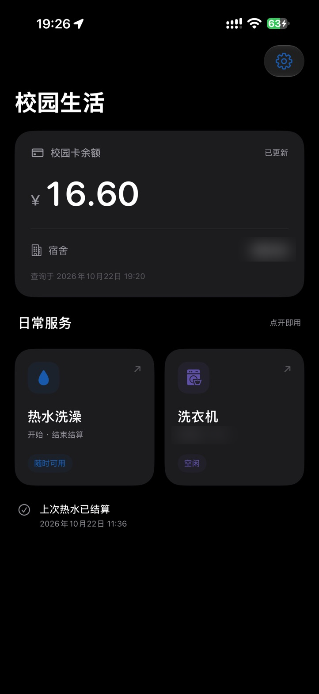
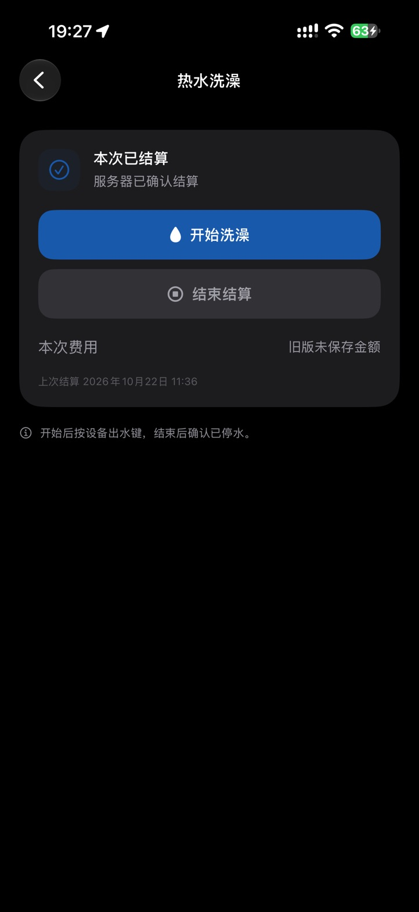
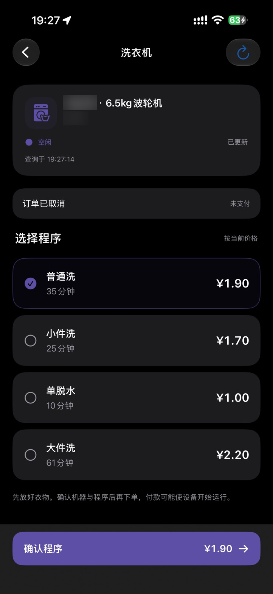
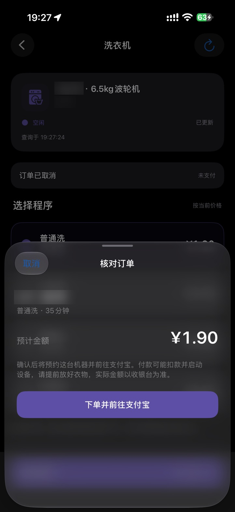

# 校日常

广东工商职业技术大学的一个非官方 iPhone 校园生活工具，把校园卡余额、宿舍信息、热水洗澡和 U净洗衣放到一起。

做这个 App 的原因很简单：我自己在学校洗澡、洗衣服，每次都要打开小程序，再找入口、跳页面，有时还要经过广告。每天都要做的事，想让它少一点步骤。

所以做了「校日常」。桌面叫校日常，首页叫校园生活，保留原来的图标。它目前只围绕我在广东工商职业技术大学的实际使用开发，不代表学校或服务商，也不声称其他学校通用。

**当前是需要自行配置、自行签名的早期源码版本。没有 TestFlight，也没有下载后所有人都能直接安装使用的公开 IPA。** 如果暂时没有 Mac、Xcode 或本人有效配置，可以先看功能与限制，再决定是否参与测试。

## 能做什么

| 功能 | 当前行为与验证范围 |
| --- | --- |
| 校园卡与宿舍 | 首页集中显示余额、宿舍与查询时间；本人已实际查询使用。失败保留上次有效余额并标记状态，不把错误当作余额为零。 |
| 热水洗澡 | iPhone 连接已配置水控，申请本次授权并结束结算；本人已实机使用成功。开始后仍可能需要按水控实体出水键，结束后要确认现场已停水。 |
| 热水快捷指令 | 提供「开始洗澡」「结束结算」两个 App Intents，执行时打开 App。快捷指令、Siri 和操作按钮的具体使用方式需分别验收；不代表洗衣业务也有同样的快捷指令。 |
| U净洗衣 | 查询已配置机器的状态、程序、时长和当前价格；核对后可「下单并前往支付宝」。后台签发链接的实际跳转已有本人成功反馈，支付宝确认、U净授权及网络仍然存在。实际扣费与机器启动不在当前独立验收结论内。 |
| 订单核对 | 保留本机订单与未确认阶段，提供查询和符合条件的取消入口。离线测试覆盖防重与异常分支；有效订单的真实取消效果尚未独立验收。 |

## 真实界面

2026-10-22 本人 iPhone 上的实际画面，宿舍与机器信息按要求做高斯模糊，其余截图像素保留。洗衣页当时查询为空闲；核对页仅为下单前预览，没有为了截图产生预约或付款。价格和状态只代表截图时刻。

<p>
  
  
  
  
</p>

## 开始之前

需要：

- 一台装有完整 Xcode 的 Mac，以及可自行签名的 Apple 账号。
- iOS 17 或更新系统的 iPhone；当前安装与使用证据来自本人的手机。
- 本人合法取得、有效且与目标设备对应的配置。校园卡、热水和 U净分别配置，身份不能混用。
- 热水需要靠近已配置水控并允许蓝牙；洗衣付款仍需支付宝及相关官方授权。

免费 Personal Team 安装通常有约 7 天的签名期限，需要自行刷新或重新签名。源码、Release 压缩包和 IPA 是不同的东西，下载源码不会绕过签名与登录门槛。

先看 [配置教程](docs/configuration.md)、[构建与签名](docs/build-and-signing.md)，需要 AI 帮忙可用 [AI 辅助上手](docs/ai-guide.md)。

## 构建

本项目以 Swift 6 工具链、Swift 5 语言模式构建。开发记录使用 Xcode 27.1；其他 Xcode 版本未逐一验收。

支付宝 SDK 为独立第三方依赖。公开仓库只保留其来源与许可证，二进制依赖的获取步骤见 [构建与签名](docs/build-and-signing.md)。

```sh
python3 tools/fetch_alipay_sdk.py
python3 tools/generate_project.py
open CampusHotWater.xcodeproj
```

在 Xcode 选择自己的 Team 与可用的 Bundle Identifier。修改 Bundle Identifier 时，同时核对支付宝回跳 scheme，详见构建教程。不要使用作者的开发签名、设备信息或描述文件。

离线核心测试：

```sh
DEVELOPER_DIR=/Applications/Xcode.app/Contents/Developer swift test
```

`Sources/WaterCore` 是协议、网络与交易状态机；`App` 是 SwiftUI、CoreBluetooth、本机存储和 App Intents；`Tests` 使用模拟依赖，不产生用水、预约或付款。

## 使用与异常处理

热水：导入自己的完整配置 → 靠近水控 → 开始洗澡 → 按现场需要操作实体出水键 → 结束结算 → 确认现场停水。App 看不到实际水流。

洗衣：先放好衣物 → 查看当前机器和程序 → 核对金额 → 下单并前往支付宝 → 在官方收银台核对并完成操作 → 回到 App 或官方入口确认订单。不要把跳转成功当作付款或机器运行成功。

遇到超时、付款待确认或结算待核对，先确认现场安全与官方账单，不要连续点击、重复预约或卸载 App 清除记录。具体见 [故障排查](docs/troubleshooting.md)。

## 隐私

个人配置保存在本机钥匙串；订单、缓存与部分交易诊断响应保存在受 iOS 文件保护的本机目录。诊断响应可能包含订单或付款信息，因此也属于私有数据。普通配置导入不会替你删除「文件」App 中的原文件。

不要在 Issue、评论或 AI 对话中上传完整配置、HAR、Cookie、token、手机号、学号、宿舍号、设备二维码、付款链接或授权 state。使用 AI 时只提供占位配置与脱敏错误信息。详见 [隐私说明](docs/privacy.md)。

## 当前版本与测试

首发准备版本为 **0.4.6 / build 12**。开发记录中，0.4.5 的 68 项离线测试通过；0.4.6 的名称调整已完成签名编译、安装、原图标一致性与交易文件保留检查。这些证据不等于每条真实交易路径都已验收。

[验收范围](docs/acceptance.md) 区分本人实测、用户反馈、编译与离线测试。公开副本已重新通过 68 项离线测试及 iPhoneOS 不签名构建。测试命令见构建教程；不代表新增真实交易验收。

## 想一起试试

优先找广东工商职业技术大学、使用 iPhone，愿意自行签名并保护个人配置的同学。

可通过仓库的 [测试意向 Issue](https://github.com/JasonBeam/xiaorichang/issues/new?template=tester.yml) 留下 iOS 版本、是否有 Mac/Xcode、想测试的功能；不用填写姓名、学号、手机号、宿舍或设备编号。测试意向不代表已经取得可安装包，也不承诺立即适配所有机器。

## 许可与致谢

原创代码使用 [MIT License](LICENSE)。支付宝 SDK 的许可证与来源独立保留于 `Vendor/AlipaySDK-15.8.30/`，其品牌与服务不属于本项目。协议调查参考见 [U净集成说明](docs/ujing-research.md)。
