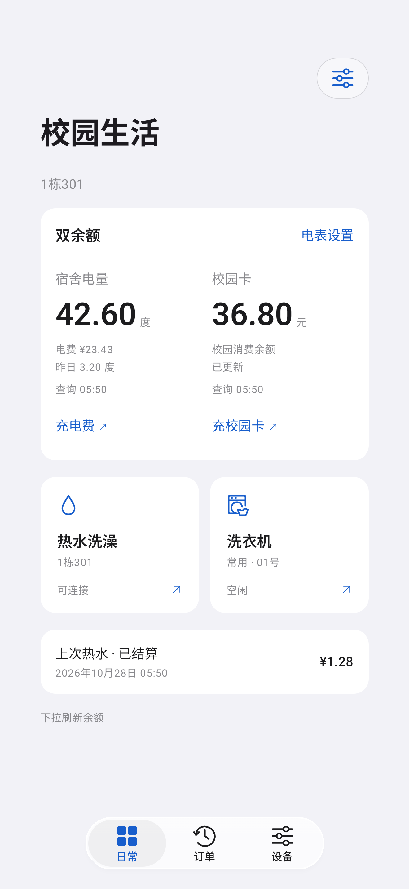
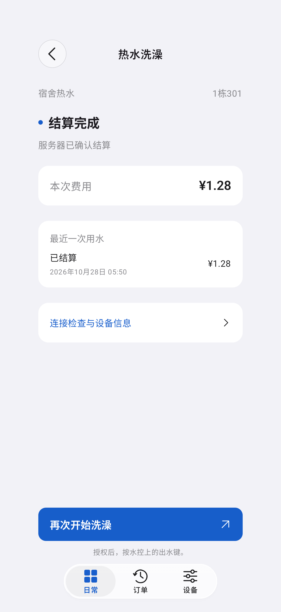
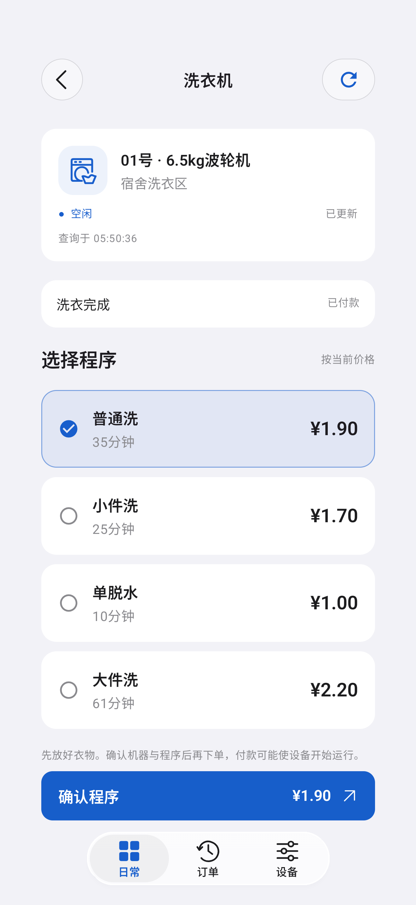
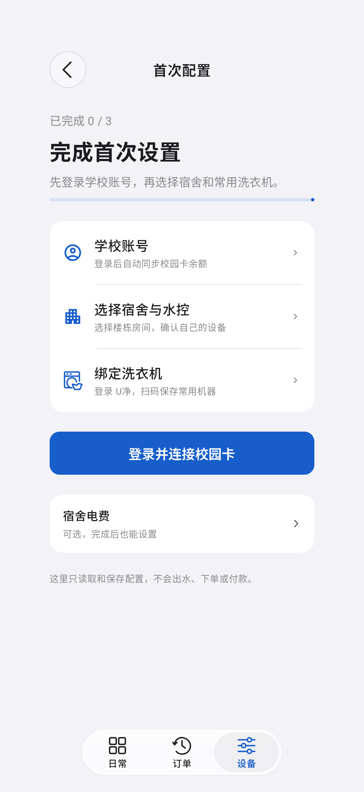

# 界面预览

以下是 Android 0.2.0-alpha12 的界面布局参考图，早于当前 Beta 2。画面由项目内的预览页面渲染，使用虚构的余额、宿舍和订单示例；按钮不会向校园、热水或洗衣服务发送请求。页面细节可能与 alpha22 不同。

这些图片用于展示页面结构，不是 iPhone 实机截图，也不证明真实登录、出水、结算、下单或付款已经通过。iPhone 当前版本的实机页面素材完成隐私检查后再补充。
